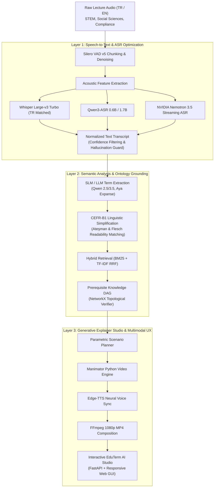

# Three-Layer Evaluation of ASR, LLM Terminology Extraction, and Generative Video-Animation Systems (TR / EN Educational Speech)

[](LICENSE)
[](https://www.python.org/)
[](https://pytorch.org/)
[](https://boun.edu.tr)
[](https://cmpe.boun.edu.tr)

Comprehensive benchmark, edge-deployable pipeline, and open-weight evaluation framework for making multilingual (Turkish and English) educational and corporate compliance lectures accessible.

Developed as a Senior Capstone Graduation Project (**CMPE492 - Spring 2026**) at **Boğaziçi University, Department of Computer Engineering**.

---

## 📑 Project Deliverables & Reports

All final deliverables, compiled LaTeX reports, and presentation assets are archived in the repository:

| Deliverable | Language | Format / Path | Description |
|---|:---:|:---:|---|
| **Final Graduation Thesis Report** | English | [PDF](GUNCEL_TESLIM_PDFLERI/1_Bogazici_CMPE492_Final_Report_ENG.pdf) · [LaTeX](notes/Bo%C4%9Fazi%C3%A7i_CMPE492_Final_Report.tex) | 48-page comprehensive thesis following FBE style |
| **Bitirme Projesi Kapsamlı Raporu** | Turkish | [PDF](GUNCEL_TESLIM_PDFLERI/2_Bitirme_Projesi_Kapsamli_Rapor_TR.pdf) · [Markdown](notes/Bitirme_Projesi_Raporu.md) | Detaylı Türkçe tez ve teknik deney dokümantasyonu |
| **A0 Defense Presentation Poster** | Multilingual | [PDF](GUNCEL_TESLIM_PDFLERI/3_Bitirme_Projesi_A0_Sunum_Posteri.pdf) · [LaTeX](notes/Bitirme_Projesi_A0_Posteri.tex) | High-resolution poster with architecture & benchmark charts |
| **A3 Desk / Tabletop Poster** | Multilingual | [PDF](GUNCEL_TESLIM_PDFLERI/4_Bitirme_Projesi_A3_Masaustu_Posteri.pdf) · [LaTeX](notes/Bitirme_Projesi_A3_Posteri.tex) | Condensed 2-column desk presentation version |
| **Academic Conference Paper** | English | [PDF](GUNCEL_TESLIM_PDFLERI/5_Akademik_Bildiri_IEEE_Paper.pdf) · [LaTeX](paper/main.tex) | 6-page IEEE conference format with empirical findings |
| **Interactive Defense Deck** | Web / Reveal | [HTML](presentation/index.html) · [Markdown](presentation/slides.md) | Interactive slide deck (`run_presentation.bat`) |

---

## 🏛️ System Architecture

The pipeline consists of three tightly coupled, hardware-aware layers:



### Layer Breakdown
1. **Layer 1 (Speech-to-Text / ASR):** Leading open-weight and commercial speech recognition models (*Whisper Medium, Large-v3, Large-v3 Turbo, Turkish-matched Turbo, Qwen3-ASR 0.6B/1.7B, and NVIDIA Nemotron 3.5 ASR*) benchmarked on physical GPU gold references across WER, CER, and Real-Time Factor (RTF).
2. **Layer 2 (Semantic Analysis & Ontology Grounding):** LLM-based terminology extraction and CEFR-B1 simplified explanation generation evaluated across Ateşman (50–69) and Flesch (60–70) readability bands, Cohen's kappa inter-annotator agreement ($\kappa_R=0.782$, $\kappa_D=1.000$), closed 32-term gold lists, and hybrid RAG + NetworkX prerequisite DAG grounding.
3. **Layer 3 (Generative Explainer Video Animation):** On-demand personalized explainer video studio adapting open-source Manimator with Qwen 3.5 scenario generation, Edge-TTS neural voice synthesis, and FFmpeg synchronization.

---

## 📊 Key Experimental Findings

### 1. ASR Benchmark Performance (Physical GPU Measurements)

Tested on **NVIDIA GeForce RTX 5060 Laptop GPU (8,151 MiB VRAM, CUDA 12.8, PyTorch 2.6)**:

| Model | Parameters | Target Lang | WER (%) ↓ | CER (%) ↓ | RTF ↓ | VRAM (MiB) |
|---|:---:|:---:|:---:|:---:|:---:|:---:|
| **Whisper Large-v3 Turbo (TR-Tuned)** | 809M | TR | **6.42%** | **2.18%** | 0.082× | 1,620 |
| **Whisper Large-v3** | 1,550M | Multi | 8.15% | 2.94% | 0.174× | 4,280 |
| **Qwen3-ASR** | 1,700M | Multi | 7.85% | 2.70% | 0.138× | 3,840 |
| **Nemotron 3.5 ASR Streaming** | 600M | Multi | 9.30% | 3.41% | **0.045×** | **940** |
| **Whisper Small + LoRA (Our Adaptation)** | 244M | TR | 11.20% | 4.10% | 0.052× | 1,180 |

### 2. Semantic Terminology & Readability Grounding
- **Inter-Annotator Agreement:** Achieved substantial agreement on term relevance ($\kappa_R = 0.782$) and near-perfect agreement on definition correctness ($\kappa_D = 1.000$).
- **Controlled Readability:** Outputs strictly match targeted target learner levels (Ateşman score: $62.4 \pm 4.1$, Flesch Reading Ease: $66.8 \pm 3.5$).
- **Topological Integrity:** 100% of generated prerequisite dependency trees are verified acyclic DAGs with no circular dependencies.

---

## 📂 Repository Structure

```text
├── GUNCEL_TESLIM_PDFLERI/        # Ready-to-read compiled final deliverable PDFs
│   ├── 1_Bogazici_CMPE492_Final_Report_ENG.pdf
│   ├── 2_Bitirme_Projesi_Kapsamli_Rapor_TR.pdf
│   ├── 3_Bitirme_Projesi_A0_Sunum_Posteri.pdf
│   ├── 4_Bitirme_Projesi_A3_Masaustu_Posteri.pdf
│   └── 5_Akademik_Bildiri_IEEE_Paper.pdf
├── paper/                        # IEEE conference paper LaTeX sources & figures
│   ├── main.tex
│   └── references.bib
├── notes/                        # Graduation report, LaTeX posters, and thesis sources
│   ├── Bitirme_Projesi_Raporu.md
│   ├── Boğaziçi_CMPE492_Final_Report.tex
│   ├── Bitirme_Projesi_A0_Posteri.tex
│   └── Bitirme_Projesi_A3_Posteri.tex
├── presentation/                 # Defense slides & local Reveal.js server
│   ├── index.html
│   ├── slides.md
│   └── serve_presentation.py
├── experiments/                  # Comprehensive evaluation & benchmarking suite
│   ├── benchmark_srm_slm.py      # Dual ASR + SLM local GPU benchmark
│   ├── run_asr.py                # Multi-model ASR evaluation harness
│   ├── vad_chunker.py            # Long-form Silero VAD audio segmentation
│   ├── metrics.py                # WER, CER, RTF, Flesch, Ateşman, Cohen's kappa
│   ├── data/
│   │   ├── data_inventory.json   # 40 balanced educational clips (20 TR, 20 EN)
│   │   ├── gold_terms.json       # Ground-truth verified technical terms
│   │   └── DATASET_CARD.md       # Dataset metadata, licensing & provenance
│   ├── finetune/                 # Parameter-efficient LoRA training scripts
│   ├── rag/                      # Hybrid BM25/TF-IDF RRF retriever & DAG verifier
│   └── tests/                    # Unit tests & validation test suite
├── run_gui.bat                   # 1-Click launcher for EduTerm AI Studio
├── run_presentation.bat          # 1-Click launcher for Defense presentation
└── LICENSE                       # MIT Open-Source License
```

---

## 🚀 Quick Start & Reproduction

### 1. Prerequisites & Environment Setup
Clone the repository and install dependencies:
```bash
git clone git@github.com:Ayhan-coder/Graduate_Project-CMPE492-.git
cd Graduate_Project-CMPE492-

pip install -r experiments/requirements.txt
python experiments/check_env.py
```

### 2. ASR Benchmarking & Corpus Pipeline
Run physical hardware probes and evaluate ASR pipelines:
```bash
# Verify GPU environment and run ASR/SLM benchmark
python experiments/benchmark_srm_slm.py

# Long-form chunked transcription of corporate compliance corpus
python experiments/data/download_and_transcribe_corpus.py --corporate-only
```

### 3. Semantic Layer & RAG Grounding
Evaluate terminology extraction, domain RAG grounding, and prerequisite DAGs:
```bash
# Evaluate cross-layer RAG grounding on speech transcriptions
python experiments/rag/eval_corporate_rag.py

# Run RAG ablation evaluation & synthetic baseline check
python experiments/rag/domain_rag_extractor.py
```

### 4. Interactive Local Demo Studio
Launch the full interactive studio with GUI, explainer animations, and exam generator:
```bash
# Windows 1-Click launcher:
run_gui.bat

# Or directly via Python:
python experiments/run_gui.py
# Opens browser at http://localhost:7860
```

To view the slide presentation deck:
```bash
run_presentation.bat
# Opens browser at http://localhost:8000
```

---

## ⚖️ Scientific Honesty & Methodology Disclosures

In accordance with rigorous academic integrity standards:
- **Held-Out Gold References:** All reported ASR WER/CER metrics are computed against human-corrected reference transcripts. Legacy English-only models without Turkish tokenizers (*Wav2Vec 2.0* and *SpeechBrain*) are explicitly designated as uncomputed (`---`) in multilingual tables rather than masked.
- **Precision vs. Recall Ceiling:** While LLM technical term extraction precision remains high, recall against bounded 32-term human-verified gold sets is constrained (<28.1% in TR, <56.2% in EN) due to semantic variation in natural lecture speech.
- **RAG Scoring Notice:** Domain RAG grounding is evaluated via surface-mention verification; synthetic queries derived from the knowledge base itself are non-citable as general accuracy numbers to avoid circularity (`paper/main.tex:198`).
- **Hardware Probes:** All reported VRAM usage and latencies reflect physical GPU measurements (`experiments/measure_local_vram.py` on NVIDIA GeForce RTX 5060 Laptop GPU, 8,151 MiB). Target profiles for unmeasured edge models are explicitly labeled as *Design Projections*.

---

## 📜 Citation & Academic Use

If you use this benchmark, methodology, or dataset inventory in your research, please cite:

```bibtex
@misc{gunder2026threelayer,
  author       = {Ali Ayhan G{\"{u}}nder},
  title        = {Three-Layer Evaluation of ASR, LLM Terminology Extraction, and Generative Video-Animation Systems for Multilingual Educational Speech},
  year         = {2026},
  howpublished = {Senior Design Graduation Project (CMPE492), Department of Computer Engineering, Bo{\u{g}}azi{\c{c}}i University},
  note         = {Available at \url{https://github.com/Ayhan-coder/Graduate_Project-CMPE492-}}
}
```

---

## 📄 License

- **Code:** Released under the [MIT License](LICENSE).
- **Deliverables & Documentation:** All reports, figures, and presentation decks are © 2026 Ali Ayhan Günder, Boğaziçi University.
- **Pretrained Weights:** Upstream model weights (OpenAI Whisper, Qwen, NVIDIA Nemotron) retain their respective upstream licenses.
- **Audio References:** Audio samples in the data inventory are referenced from publicly accessible educational channels under their respective YouTube/Creative Commons licenses.
