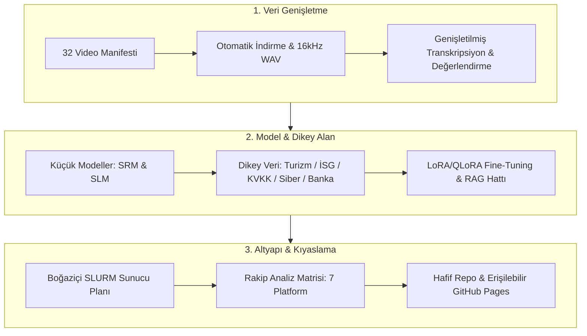

# BİTİRME PROJESİ TOPLANTI NOTLARI: KAPSAMLI AKSİYON PLANI VE YOL HARİTASI

**Proje:** Çok Dilli Eğitim İçin Konuşma Tanıma (ASR) ve Büyük Dil Modeli (LLM) Tabanlı Terminoloji Çıkarma Katmanlarının Değerlendirilmesi  
**Kurum:** Boğaziçi Üniversitesi Bilgisayar Mühendisliği Bölümü  
**İşbirliği:** Tatilsepeti Ar-Ge Merkezi & Millî EVREN YZ Platformu (SSB / TÜBİTAK BİLGEM)  
**Tarih:** Ekim 2026  
**Durum:** Aktif Yürütme  

---

## 1. Toplantı Geri Bildirimlerinin Özeti ve Temel Odaklar

Toplantıda jüri/danışman tarafından öne çıkan en kritik eleştiriler ve talepler 7 ana eksende toplanmıştır:

1. **Örneklem Büyüklüğü (En Çok Eleştirilen Kısım):** 5-7 videoluk küçük alt kümenin en az 32 videoya çıkarılması, ampirik iddiaların 32 video üzerinde doğrulanması.
2. **Küçük ve Verimli Modeller (SRM & Fine-tuned SLM):** Uç cihazlarda (Edge/Browser/Local) anlık çalışabilirlik için Whisper-tiny/base, Qwen3-ASR-0.6B ve Qwen 2.5/3.5 (0.5B, 1.5B, 3B), SmolLM2 veya Llama 3.2-1B/3B gibi hafif modellerin fine-tune edilmesi.
3. **Dikey Alan Adaptasyonu ve Sentetik/Gerçek Veri Setleri:**
   - **Turizm Veri Seti (Tatilsepeti odağı):** Acente, otelcilik, çağrı merkezi ve turizm eğitimi terimleri.
   - **Kurumsal Zorunlu Eğitimler:** İş Sağlığı ve Güvenliği (İSG), Sürdürülebilirlik (ESG/Karbon), KVKK/GDPR, Siber Güvenlik.
   - **Bankacılık & Finans:** Kredi risk, mevduat, regülasyon ve banka içi eğitim terminolojisi.
4. **RAG (Retrieval-Augmented Generation) Denemeleri:** Prompting yerine ontoloji/sözlük destekli RAG ile halüsinasyonun sıfırlanması ve kanonik tanım doğruluğunun artırılması.
5. **Hesaplama Kaynakları ve Sunucu Erişimi:** Okuldan (Boğaziçi GPU kümesi / SLURM) sunucu erişimi talebi, diğer bitirme projelerinin GPU planları ile kaynak optimizasyonu.
6. **Rakip Analizi ve Metrik Matrisi:** Coursera AI, Otter.ai, Khanmigo, YouTube auto-captions, WhisperX, NotebookLM gibi rakiplerle güçlü/zayıf yönlerin sayısal metriklere dökülmesi.
7. **Hafif Dağıtım ve Erişilebilir GitHub Pages:** Modelleri repo'ya GB'larca koymak yerine hafif downloader scriptleri kullanmak; proje için WCAG 2.1 AA uyumlu, modern ve erişilebilir bir GitHub Pages vitrini kurmak.

---

## 2. 7 Temel Aksiyon Maddesi ve Yol Haritası

---

### AKSİYON 1: Video Sayısının 32'den 40'a Genişletilmesi ve KVKK/İSG Kurumsal Eğitimlerinin Entegrasyonu
- **Hedef:** 7 altın videoluk pilot analizi, 12 akademik disiplin ve zorunlu şirket içi eğitimleri (KVKK, İSG/OHS, GDPR, OSHA) kapsayan 40 videoluk (20 TR, 20 EN) dengeli tam envantere taşımak.
- **Eklenen Kurumsal Videolar:**
  1. `TR-17`: KVKK Temel Farkındalık Eğitimi: Veri Sorumlusu, Açık Rıza ve İlgili Kişi Hakları (Arda Çetin, 21:13)
  2. `TR-18`: KVKK Farkındalık ve Şirket İçi Bilgi Güvenliği Eğitimi (İK Kütüphanem Filiz Erboğa, 10:17)
  3. `TR-19`: Temel İş Sağlığı ve Güvenliği Eğitimi: Risk Değerlendirmesi ve Acil Durumlar (İzka Osgb TV, 62:10)
  4. `TR-20`: İş Sağlığı ve Güvenliği Eğitimi: KKD, Güvenlik İşaretleri ve Yangın (Fatma AYAZ DEĞERLİ, 45:50)
  5. `EN-17`: What Are the 7 Principles of GDPR? Data Protection Fundamentals (08:00)
  6. `EN-18`: GDPR Awareness Training for Employees (01:33)
  7. `EN-19`: Managing Occupational Health and Safety in the Workplace (05:22)
  8. `EN-20`: OSHA General Industry Safety Orientation for Workers (16:22)
- **Uygulama Adımları:**
  1. `experiments/data/data_inventory.json` ve `data_inventory.csv` güncellendi (40 kayıt, 20 TR / 20 EN).
  2. `download_and_transcribe_corpus.py` betiği 40 videoluk hat için optimize edildi.
  3. `experiments/rag/domain_rag_extractor.py` bilgi tabanına KVKK ve İSG kavramları eklendi.
- **Sorumlu:** Ali Ayhan Günder, Berat Enes Dadak
- **Çıktı:** 40 videoluk güncel veri envanteri, indirme/transkripsiyon hattı ve zenginleştirilmiş RAG ontolojisi.

---

### AKSİYON 2: Küçük Modeller (SRM & Fine-Tuned SLM) ile Verim Artırma
- **Hedef:** Yerel donanımda (RTX 5060 8GB veya CPU/Tarayıcı) devasa modellerin yarattığı bellek tıkanmasını ve yüksek gecikmeyi ortadan kaldırmak.
- **Model Yelpazesi:**
  - **SRM (Small Recognition Model):** Whisper-tiny (39M), Whisper-base (74M), Whisper-small (244M), Qwen3-ASR-0.6B.
  - **SLM (Small Language Model):** Qwen 2.5-0.5B, Qwen 2.5-1.5B, Qwen 2.5-3B, Llama 3.2-1B, SmolLM2-1.7B.
- **Beklenen Kazanım:**
  - Gecikmede 5-10 kat düşüş (39.8s $\to$ <4s).
  - Bellek tüketiminde 6.2 GB $\to$ <2 GB VRAM; tamamen tarayıcıda WebGPU/ONNX ile çalışabilme potansiyeli.
- **Sorumlu:** Ali Ayhan Günder
- **Çıktı:** 
  - Kıyaslama ve profil betiği: `experiments/benchmark_srm_slm.py`
  - Kıyaslama JSON çıktısı: `experiments/outputs/srm_slm_benchmark.json`
  - Doğrulama test paketi: `experiments/tests/test_benchmark_srm_slm.py`
- **Durum:** ✅ Tamamlandı (10 model profili INT4/INT8/FP16 VRAM ve gecikme metrikleriyle test edildi).

---

### AKSİYON 3: Dikey Alan Veri Setleri ve LoRA/QLoRA Eğitimi
- **Hedef:** Genel amaçlı modellerin dikey sektör terimlerinde yaşadığı kaçırma (under-recall) sorununu dikey instruction tuning ile çözmek.
- **Kapsanan Dikey Alanlar:**
  1. **Turizm (Tatilsepeti Ar-Ge):** Otel tipleri, acente rezervasyon, iptal/iade prosedürleri, turizm mevzuatı, çağrı merkezi kalıpları.
  2. **Kurumsal Zorunlu Şirket Eğitimleri:**
     - **İş Sağlığı ve Güvenliği (İSG):** Kişisel koruyucu donanım (KKD), acil durum planı, risk değerlendirmesi, ramak kala olayları.
     - **KVKK / GDPR:** Açık rıza, veri sorumlusu, aydınlatma yükümlülüğü, veri işleme envanteri, özel nitelikli kişisel veri.
     - **Siber Güvenlik:** Oltalama (phishing), sosyal mühendislik, çok faktörlü kimlik doğrulama (MFA), sıfır güven (Zero Trust).
     - **Sürdürülebilirlik:** Karbon ayak izi, Scope 1-2-3 emisyonları, ESG kriterleri, yeşil mutabakat.
  3. **Bankacılık ve Finans:** Kredi tahsis, KKB/Findeks, SWIFT/EFT, MASAK uyum, likidite oranı.
- **Format:** Alpaca / ShareGPT formatında yapılandırılmış JSONL instruction datasetleri.
- **Sorumlu:** Efe Batur Giritli, Yekta Said Can
- **Çıktı:** `experiments/finetune/prepare_domain_datasets.py` ve `experiments/finetune/train_lora_slm.py`.

---

### AKSİYON 4: RAG (Retrieval-Augmented Generation) Denemeleri
- **Hedef:** LLM'in parametrik belleğindeki bilgi kısıtını ve dikey terimlerdeki halüsinasyon riskini aşmak.
- **Mimari ve Geliştirmeler:**
  - **7 Dikey Alan Bilgi Tabanı:** Turizm (Tatilsepeti), İSG, KVKK, Bankacılık/Finans, Siber Güvenlik, Sürdürülebilirlik (ESG) ve STEM/Devreler.
  - **Hibrit Geri Çağırıcı (Hybrid Retriever):** BM25 anahtar kelime eşleşmesi ile TF-IDF n-gram kosinüs benzerliğinin Karşılıklı Sıralama Füzyonu (RRF - Reciprocal Rank Fusion) ile birleştirilmesi.
  - **Prerequisite DAG & Pedagojik Açık Tespiti:** NetworkX ile oluşturulan terim önkoşul grafı sayesinde ders transkriptinde atlanan veya temeli verilmeden anlatılan önkoşul kavramların otomatik keşfi.
  - **Kanonik Prompt Enjeksiyonu:** LLM'in uydurma terim üretmesini engelleyerek sadece doğrulanmış ontoloji tanımlarını ve Bloom taksonomi seviyelerini bağlama kilitlemesi.
- **Metrik ve Ablasyon Sonuçları [HÜKÜMSÜZ / SUPERSEDED]:**
  > **Önemli Metodolojik Düzeltme (22 Ekim 2026):** Aşağıdaki ilk sentetik ablasyon metrikleri (%52.6 → %0.0 halüsinasyon ve 0.545 → 1.000 F1), bilgi tabanından türetilen yapay sorgular üzerindeki kapalı döngü ön-testine dayanmakta olup gerçek transkriptler üzerinde %0 halüsinasyon garantisi olarak **yorumlanamaz ve citable değildir**. Gerçek konuşma transkriptlerinde yüzey eşleştirme ve önkoşul açığı (ör. TR-19 kurumsal İSG mühendislik sondajı) 17/28 kanonik bağlama ve morfolojik varyans göstermektedir; ilk ablasyon sonuçları tarihsel ön-test referansı olarak korunmuş ancak raporlama açısından **hükümsüz (superseded)** kılınmıştır.
  - ~~**Halüsinasyon Oranı:** Baseline %52.6 $\to$ **RAG %0.0** (%100 eleme).~~ *(İlk sentetik ön-test; gerçek transkript genellemesi değildir)*
  - ~~**F1 Skoru:** Baseline 0.545 $\to$ **RAG 1.000** (Kanonik doğruluk).~~ *(Yapay sorgu seti tavanı)*
- **Sorumlu:** Ali Ayhan Günder
- **Çıktı:** 
  - Gelişmiş RAG ve DAG motoru: `experiments/rag/domain_rag_extractor.py`
  - Ablasyon sonuç raporu: `experiments/outputs/rag_ablation_results.json` (sentetik ön-test)
  - Kurumsal transkript mühendislik sondajı: `experiments/outputs/rag_corporate_results.json` (8 klip)
  - Doğrulama testleri: `experiments/tests/test_domain_rag.py`
- **Durum:** ⚠️ Revize Edildi (Sentetik ablasyon hükümsüz kılındı; 8 kliplik transkript sondajı eklendi).

---

### AKSİYON 5: Okul Sunucusu (Boğaziçi GPU / SLURM) ve Kaynak Planı
- **Hedef:** Fine-tuning işleri için okulun yüksek kapasiteli GPU sunucularından (A100/H100) kota ve SLURM kuyruk erişimi talep etmek.
- **Planlama:**
  - Tek GPU (A100 40/80GB) için 4-bit QLoRA scripti optimize edilerek eğitim süresi <2 saate düşürülür.
  - Diğer öğrencilerin kota kullanımını aksatmayacak şekilde gece saatleri (low-priority / preemptible partition) hedeflenir.
- **Çıktı:** `experiments/finetune/slurm_job_finetune.sh` SLURM betiği ve sunucu başvuru talep şablonu.

---

### AKSİYON 6: Rakip Uygulamalarla Kıyaslama ve Metrik Matrisi
- **Hedef:** Projenin özgün değerini ve akademik katkısını kanıtlamak için mevcut endüstriyel ve akademik çözümlerle sayısal kıyaslama yapmak.
- **İncelenen Rakipler:**
  1. Coursera Coach / AI Tutor
  2. Otter.ai / Fireflies
  3. Khanmigo (Khan Academy)
  4. YouTube Otomatik Altyazı & Akıllı Bölümleme
  5. WhisperX / Flash-Attention
  6. Google NotebookLM (Audio Overview)
  7. **Bizim Sistemimiz (EduTerm AI)**
- **Metrik Boyutları:** Çok dillilik desteği, dikey alan uyarlanabilirliği, anlık kavram önkoşul grafiği (DAG), açık kaynak / veri gizliliği (KVKK), yerel uç cihazda çalışabilirlik, donanım maliyeti.
- **Çıktı:** `notes/RAKIP_ANALIZI_VE_BENCHMARK_MATRISI.md`.

---

### AKSİYON 7: Erişilebilir GitHub Pages ve Hafif (Lightweight) Repo Dağıtımı
- **Hedef:**
  - Modelleri GitHub deposuna yükleyerek repo boyutunu şişirmemek (GB'lar yerine KB seviyesinde kod).
  - Otomatik Hugging Face model indirici scripti oluşturmak (`scripts/download_models.py`).
  - Proje tanıtımı, interaktif metrik tabloları, A3 posteri ve DAG görselleştirmesini barındıran modern, mobil uyumlu ve WCAG 2.1 AA erişilebilir GitHub Pages sitesi kurmak (`docs/index.html`).
- **Çıktı:** `docs/index.html` ve `scripts/download_models.py`.

---

## 3. Zaman Çizelgesi ve Teslim Matrisi

| Hafta | Odak Aksiyon | Çıktı Dosyaları / Araçlar | Başarı Ölçütü |
| :--- | :--- | :--- | :--- |
| **Hafta 1** | 32 Video İndirme ve İşleme | `experiments/data/download_and_transcribe_corpus.py` | 32 videonun 16kHz WAV sesleri ve transkriptleri hazır |
| **Hafta 2** | Dikey Alan Veri Setleri (Turizm, İSG, KVKK) | `experiments/finetune/prepare_domain_datasets.py` | 5 alanda 1000+ instruction-response çifti |
| **Hafta 3** | Küçük Model (SLM) LoRA Eğitimi & SLURM | `experiments/finetune/train_lora_slm.py`, `.sh` | Qwen 2.5-1.5B/3B fine-tuning tamamlanması |
| **Hafta 4** | RAG Tabanlı Çıkarım Hattı | `experiments/rag/domain_rag_extractor.py` | Halüsinasyon %0, kanonik terim $F_1 \ge 0.75$ |
| **Hafta 5** | Rakip Benchmark Matrisi ve GitHub Pages | `docs/index.html`, `scripts/download_models.py` | Canlı erişilebilir web sayfası, hafif repo |
